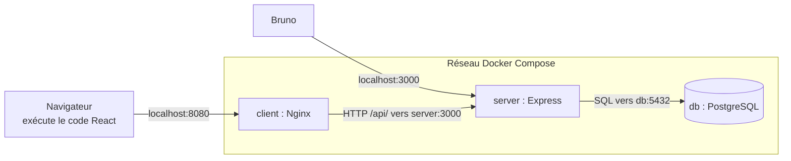
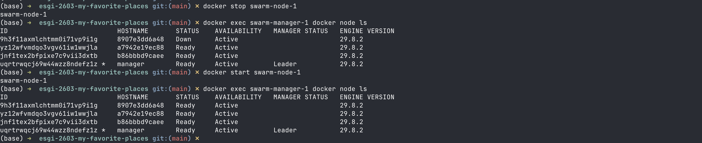
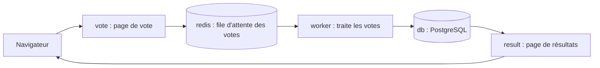

# Clusterisation de conteneurs : My Favorite Places

Ce dépôt regroupe mon travail sur les TD du module *Clusterisation de conteneurs*. Le fil rouge, My Favorite Places, est une petite application composée d'une API Express avec TypeORM (`server/`), d'un client React avec Vite (`client/`) et d'une base PostgreSQL.

| Partie | Exercice | Sujet |
|---|---|---|
| Introduction | [TD 1](#intro-td-1--dockerisation) | Dockeriser le projet |
| Introduction | [TD 2](#intro-td-2--optimisation) | Ordre de démarrage, redémarrage, taille des images |
| Docker Swarm | [TD 1](#swarm-td-1--dind-et-dood) | Docker-in-Docker et Docker-out-of-Docker |
| Docker Swarm | [Prérequis](#swarm-prérequis--images-sur-un-registry) | Publier les images sur un registry |
| Docker Swarm | [TD 2](#swarm-td-2--création-du-cluster) | Créer le cluster |
| Docker Swarm | [TD 3](#swarm-td-3--tests-du-cluster) | Tester le cluster |
| Traefik | [Exercice 1](#traefik-exercice-1--déployer-traefik) | Déployer Traefik |
| Traefik | [Exercice 2](#traefik-exercice-2--déployer-une-autre-application) | Déployer une autre application |

## Lancer le projet

```bash
# l'application : front sur http://localhost:8080, API sur http://localhost:3000/api
docker compose up -d --build

# le cluster Swarm local (init et join sont détaillés dans le TD 2 Swarm)
cd swarm && docker compose up -d
```

La collection Bruno se trouve dans `bruno/`. Elle a deux environnements : `local` pour appeler l'API directement, et `front` pour passer par Nginx.

---

## Intro, TD 1 : dockerisation

### 1. Tester le serveur avec `yarn dev` et Bruno

Pour tourner, `yarn dev` a besoin d'un PostgreSQL sur `localhost:5432`. J'en ai donc lancé un dans un conteneur temporaire.

```bash
docker run -d --name mfp-pg-tmp -e POSTGRES_PASSWORD=supersecret -p 5432:5432 postgres:17-alpine
cd server
yarn dev
```


Ensuite, j'ai créé un compte depuis Bruno, et l'API répond bien `200 OK` :


### 2. Dockeriser le serveur

J'ai d'abord dû modifier `server/src/datasource.ts` pour qu'il lise la configuration de la BDD dans des variables d'environnement (`DB_HOST`, etc.). Sinon, une fois dans son conteneur, le serveur chercherait la BDD sur `localhost`, c'est-à-dire chez lui.

```bash
cd server
docker build -t mfp-server .
docker run -d --name mfp-server-tmp -p 3000:3000 -e DB_HOST=host.docker.internal mfp-server
docker ps
```


La connexion depuis Bruno fonctionne aussi sur le serveur conteneurisé : j'obtiens un `200 OK` et un token.


### 3. `compose.yml` : serveur et BDD

```bash
docker compose up -d --build db server
docker compose ps
```


### 4. Client React

J'ai commencé par le tester en développement. Le proxy Vite se charge d'envoyer `/api` vers `localhost:3000`.

```bash
cd client
yarn dev
```


Pour le dockeriser, Vite construit l'application, puis Nginx sert les fichiers. `client/nginx.conf` envoie `/api/` vers `http://server:3000` et renvoie toutes les autres routes vers `index.html`, pour que react-router fonctionne.

```bash
docker compose up -d --build
docker compose ps
```


### 5. Comment communiquent les services ?



**Entre la BDD et le serveur :** Compose crée un réseau commun avec un DNS interne, où chaque nom de service sert de nom d'hôte. Le serveur joint donc la base sur `db:5432`, avec le protocole PostgreSQL. Comme le port 5432 n'est pas publié, la BDD n'est accessible que depuis ce réseau.

**Entre le serveur et le front :** le code React s'exécute dans le navigateur et non dans le conteneur, et le navigateur ne connaît pas le nom `server`. Le front appelle donc des URLs relatives (`/api/...`) sur `localhost:8080`, puis Nginx les transmet à `server:3000`. Comme la page et l'API ont la même origine, il n'y a pas de souci de CORS.

---

## Intro, TD 2 : optimisation

### 1. Démarrer le serveur une fois la BDD prête

J'ai ajouté un healthcheck à `db`, et `server` attend qu'il passe au vert. Sans `condition: service_healthy`, Compose attendrait seulement que le conteneur soit lancé, alors que PostgreSQL met quelques secondes à accepter des connexions.

```yaml
db:
  healthcheck:
    test: ["CMD-SHELL", "pg_isready -U postgres -d postgres"]
    interval: 5s
    timeout: 5s
    retries: 10
server:
  depends_on:
    db:
      condition: service_healthy
```

### 2. Redémarrage automatique, sauf arrêt manuel

Les 3 services ont `restart: unless-stopped`.

J'ai aussi modifié `server/src/index.ts` pour qu'il quitte avec `process.exit(1)` si la connexion à la BDD échoue. Avant, le serveur affichait l'erreur mais restait vivant sans rien servir, et Docker n'avait donc aucune raison de le relancer.

Pour vérifier, j'ai fait deux tests :

| Test | Résultat |
|---|---|
| `kill -9` du processus du serveur | Il redémarre seul (`RestartCount` à 1, statut `running`) |
| `docker compose stop server` | Il reste arrêté (`exited`) |

### 3. Build stages

Un Dockerfile multi-stage enchaîne plusieurs `FROM`. Une étape peut récupérer des fichiers d'une étape précédente avec `COPY --from=...`, et seule la dernière donne l'image finale. Les outils de build ne se retrouvent donc pas en production.

`server/Dockerfile` a 4 étapes :

1. `base` : `node:24-alpine`, `package.json` et `yarn.lock`.
2. `build` : toutes les dépendances, et la compilation du TypeScript vers `dist/`.
3. `prod-deps` : uniquement les dépendances de production.
4. `runtime` : le `node_modules` de production et `dist/`, exécutés avec l'utilisateur `node`.

Un détail m'a pris du temps : `yarn install --production` (yarn v1) gardait `typescript` et `ts-node`, soit environ 25 Mo, parce que `ts-node` est aussi une dépendance optionnelle de `typeorm`. L'étape `prod-deps` retire donc les devDependencies du `package.json` avant l'installation, et `yarn.lock` garantit qu'on garde les mêmes versions.

```bash
docker build -f server/Dockerfile.naive -t mfp-server:naive server
docker build -t mfp-server:optimized server
docker images mfp-server
```


Pour mesurer le gain, j'ai comparé avec une image à une seule étape, écrite exprès (`server/Dockerfile.naive`) : on passe de 314 Mo à 200 Mo, soit 114 Mo de moins.

---

## Swarm, TD 1 : DinD et DooD

| | Docker-in-Docker (DinD) | Docker-out-of-Docker (DooD) |
|---|---|---|
| Principe | Un daemon Docker complet tourne dans le conteneur (`docker:dind`) | Le conteneur utilise le daemon de l'hôte via `/var/run/docker.sock` |
| Conteneurs lancés | Enfants du conteneur, invisibles depuis l'hôte | Frères du conteneur, créés sur l'hôte |
| Isolation | Daemon, images et conteneurs séparés de l'hôte | Aucune, tout est partagé avec l'hôte |
| Sécurité | Exige `--privileged`, à réserver au local | L'accès au socket donne le contrôle de l'hôte |
| Cache d'images | Propre à chaque conteneur | Partagé avec l'hôte |

Pour tester Swarm, c'est DinD qu'il nous faut. Chaque conteneur a son propre daemon, donc il se comporte comme un serveur à part. Avec DooD, tout le monde partage le même daemon, et on ne pourrait pas simuler plusieurs machines.

L'idée est donc de lancer 4 conteneurs DinD sur un même réseau avec un `compose.yml`. Le manager fait `docker swarm init`, puis les nodes font `docker swarm join`.

---

## Swarm, prérequis : images sur un registry

J'ai publié les images sur GitHub Container Registry, en public. Pour vérifier, je les ai téléchargées depuis un node du cluster, sans identifiants.

```bash
docker tag esgi-2603-my-favorite-places-server ghcr.io/driss-khettab/mfp-server:latest
docker tag esgi-2603-my-favorite-places-client ghcr.io/driss-khettab/mfp-client:latest
docker login ghcr.io -u Driss-Khettab
docker push ghcr.io/driss-khettab/mfp-server:latest
docker push ghcr.io/driss-khettab/mfp-client:latest
```


---

## Swarm, TD 2 : création du cluster

Tout se passe dans le dossier `swarm/`.

### 1. Lancer les conteneurs DinD

```yaml
# swarm/compose.yml
services:
  manager:
    image: docker:dind
    privileged: true
    hostname: manager
    ports:
      - "80:80" # ajouté pour Traefik
    volumes:
      - /home/manager
    networks:
      cluster:
        ipv4_address: 172.28.0.10

  node:
    image: docker:dind
    privileged: true
    networks:
      - cluster
    deploy:
      replicas: 3

networks:
  cluster:
    ipam:
      config:
        - subnet: 172.28.0.0/24
```

```bash
docker compose up -d
docker ps
docker exec -it swarm-node-1 ash
docker ps    # dans le conteneur
```

Dans le node, `docker ps` est vide alors que mon Mac fait tourner plusieurs conteneurs.


### 2. Initialiser le cluster

```bash
docker exec swarm-manager-1 docker swarm init
# Swarm initialized: current node (...) is now a manager.
```

La commande affiche le token à donner aux workers. On peut le retrouver plus tard avec `docker swarm join-token -q worker`.

### 3. Faire rejoindre les nodes

Comme demandé, j'utilise le nom du service Compose, `manager:2377`, et non l'IP du manager.

```bash
docker exec swarm-node-1 docker swarm join --token <TOKEN> manager:2377
docker exec swarm-node-2 docker swarm join --token <TOKEN> manager:2377
docker exec swarm-node-3 docker swarm join --token <TOKEN> manager:2377
```

### 4. Lister les nœuds depuis le manager

```bash
docker exec swarm-manager-1 docker node ls
```


Les workers s'affichent avec l'ID de leur conteneur, car les réplicas d'un même service ne peuvent pas avoir chacun leur `hostname`. Sur un worker, `docker node ls` est refusée : seul un manager voit l'état du cluster.

### Pourquoi une IP fixe pour le manager

Je pensais que passer par le nom `manager` suffisait à éviter les soucis d'IP, mais ce nom n'est lu qu'au moment du `join`. Ensuite, chaque worker garde l'IP en mémoire. Après un redémarrage de Docker, le manager avait changé d'IP et les 3 workers restaient `Down`.

Je lui ai donc donné l'IP fixe `172.28.0.10`, et les 4 nœuds repassent `Ready` après un `docker compose restart`.

### Test : arrêter un worker

```bash
docker stop swarm-node-1
docker exec swarm-manager-1 docker node ls
docker start swarm-node-1
docker exec swarm-manager-1 docker node ls
```

Le manager voit le worker passer `Down` quand je l'arrête, puis `Ready` une fois relancé.



---

## Swarm, TD 3 : tests du cluster

### 1. La stack

```yaml
# swarm/hello-world.compose.yml
services:
  hello:
    image: hello-world
    deploy:
      replicas: 2
```

### 2. Copier la stack sur le manager et la déployer

`/home/manager` est un volume anonyme (voir `swarm/compose.yml`), donc les fichiers restent après un redémarrage.

```bash
docker exec swarm-manager-1 mkdir -p /home/manager
docker cp hello-world.compose.yml swarm-manager-1:/home/manager/
docker exec swarm-manager-1 ls -l /home/manager
docker exec swarm-manager-1 docker stack deploy -c /home/manager/hello-world.compose.yml hello
```


### 3. Observer le déploiement

```bash
docker exec swarm-manager-1 docker service ls
docker exec swarm-manager-1 docker ps -a
docker exec swarm-node-1 docker ps -a
docker exec swarm-node-2 docker ps -a
docker exec swarm-node-3 docker ps -a
```


| Machine | Conteneurs dans `docker ps -a` |
|---|---|
| manager | 4 |
| node-1 | 2 |
| node-2 | 3 |
| node-3 | 1 |

**Ce que j'en déduis :**

- **Le `0/2` n'est pas une panne.** `hello-world` affiche son message puis s'arrête (`Exited (0)`). Par défaut, Swarm recrée tout conteneur arrêté (`restart_policy: any`), donc le service tourne en boucle sans jamais rester actif.
- **C'est Swarm qui choisit les machines.** Je demande 2 réplicas sans dire où, et chaque nouveau conteneur peut atterrir ailleurs. Ici, les 4 machines en ont exécuté, y compris le manager, qui accepte aussi des conteneurs par défaut.
- **Chaque machine ne voit que ses propres conteneurs.** `docker ps` reste local. Pour avoir la vue d'ensemble, il faut passer par le manager, avec `docker service ls` et `docker service ps`.

### 4. Faire varier `deploy`

Sur ces variantes, j'ai ajouté `restart_policy: none` pour que chaque conteneur ne s'exécute qu'une fois. Sans ça, la boucle rend le résultat difficile à lire.

| Fichier dans `swarm/` | Clause `deploy` | Résultat (`docker service ps`) |
|---|---|---|
| `hello-world.manager.compose.yml` | `replicas: 2`, `constraints: [node.role == manager]` | Les 2 réplicas sur `manager` |
| `hello-world.global.compose.yml` | `mode: global` | 1 conteneur sur chacun des 4 nœuds |
| `hello-world.worker.compose.yml` | `replicas: 3`, `max_replicas_per_node: 1`, `constraints: [node.role == worker]` | 1 conteneur sur chacun des 3 workers, aucun sur le manager |

En mode `global`, on n'indique pas de nombre de réplicas : Swarm en lance un par nœud.

---

## Traefik, exercice 1 : déployer Traefik

Un reverse proxy écoute sur les ports 80 et 443, regarde quel nom de domaine est demandé et transmet la requête à la bonne application. Ce qui est pratique avec Traefik, c'est que chaque service se déclare lui-même avec des labels : il n'y a pas de configuration centrale à modifier.

### 1. Infrastructure Swarm

Je repars du cluster de 4 nœuds, en publiant le port 80 du manager (voir `swarm/compose.yml`) pour pouvoir joindre Traefik depuis ma machine.

```bash
cd swarm
docker compose up -d
```

### 2. Déployer la stack

`swarm/traefik.yml` est la stack fournie par le cours. Le réseau `web` est de type `overlay`, ce qui lui permet de relier des conteneurs situés sur des nœuds différents. Comme la stack le déclare `external`, il faut le créer avant de déployer.

```bash
docker exec swarm-manager-1 docker network create -d overlay web
docker cp traefik.yml swarm-manager-1:/home/manager/
docker exec swarm-manager-1 docker stack deploy -c /home/manager/traefik.yml traefik
docker exec swarm-manager-1 docker stack services traefik
```


### 3. Fichier hosts

Aucun nom de domaine public ne pointe vers ma machine. Le fichier `hosts` sert donc de mini-DNS local, et il est consulté en priorité.

```bash
echo "127.0.0.1 traefik.swarm.localhost whoami.swarm.localhost vote.swarm.localhost result.swarm.localhost" | sudo tee -a /etc/hosts
```


Le dashboard de Traefik et `whoami` s'ouvrent ensuite dans le navigateur :


`whoami` tourne sur un worker alors que Traefik est sur le manager : la requête passe de l'un à l'autre par le réseau overlay `web`.

---

## Traefik, exercice 2 : déployer une autre application

### 1. Tester l'application avec Docker Compose

Il s'agit d'[example-voting-app](https://github.com/dockersamples/example-voting-app).

```bash
git clone https://github.com/dockersamples/example-voting-app
cd example-voting-app
docker compose up -d --build
```

Le vote est sur `localhost:8080` et les résultats sur `localhost:8081` :




Le vote et les résultats ne se parlent jamais directement. `vote` dépose le vote dans Redis, `worker` le récupère et l'enregistre en base, et `result` lit la base.

### 2. Déployer sur Swarm

`swarm/voting-app.yml` reprend le `docker-stack.yml` fourni par le projet, qui publie les ports 8080 et 8081.

```bash
docker cp voting-app.yml swarm-manager-1:/home/manager/
docker exec swarm-manager-1 docker stack deploy -c /home/manager/voting-app.yml vote
docker exec swarm-manager-1 docker stack ps vote --filter desired-state=running
```

Swarm répartit bien les services sur plusieurs nœuds :


### 3. Exposer les deux applications avec Traefik

Dans `swarm/voting-app.traefik.yml`, j'ai retiré les ports publiés, ajouté `vote` et `result` au réseau `web`, et déclaré les deux services avec des labels, sur le modèle de `whoami` :

```yaml
vote:
  image: dockersamples/examplevotingapp_vote
  networks:
    - frontend
    - web
  deploy:
    replicas: 2
    labels:
      - "traefik.enable=true"
      - "traefik.http.routers.vote.rule=Host(`vote.swarm.localhost`)"
      - "traefik.http.routers.vote.entrypoints=web"
      - "traefik.http.services.vote.loadbalancer.server.port=80"
```

`result` suit le même modèle, avec `result.swarm.localhost`. Les deux noms sont déjà dans le fichier `hosts`.

```bash
docker cp voting-app.traefik.yml swarm-manager-1:/home/manager/
docker exec swarm-manager-1 docker stack deploy -c /home/manager/voting-app.traefik.yml vote
```


Les 23 votes affichés comprennent des votes de test envoyés avec `curl`. J'ai aussi vérifié le chemin complet : les votes envoyés à `vote.swarm.localhost` arrivent bien dans la table `votes` de PostgreSQL.
